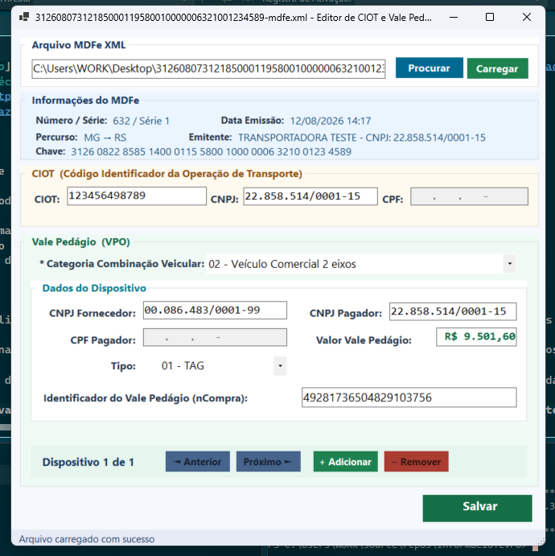

# InformarCIOTeVPO

**Ferramenta auxiliar para inclusão e edição de CIOT e Vale-Pedágio Obrigatório em arquivos XML de MDF-e.**

## Sobre o projeto

O **InformarCIOTeVPO** é uma aplicação desktop desenvolvida em C# e Windows Forms, que permite incluir e editar informações de CIOT e Vale-Pedágio Obrigatório (VPO) em arquivos XML de MDF-e.

A ferramenta facilita o preenchimento dessas informações, preservando os demais dados do documento.

## Demonstração



## Funcionalidades

- Abrir arquivos XML de MDF-e.
- Carregar arquivos por arrastar e soltar (Drag and Drop).
- Consultar e editar informações de CIOT.
- Informar CNPJ relacionado ao CIOT.
- Incluir e editar dados do Vale-Pedágio Obrigatório.
- Informar CNPJ do fornecedor e do pagador.
- Informar número de compra e dispositivos de pagamento.
- Navegar entre múltiplos dispositivos.
- Validar campos e identificar informações incompletas.
- Salvar o XML atualizado, preservando os demais dados.

## Tecnologias utilizadas

| Tecnologia | Aplicação |
|---|---|
| C# 12 | Linguagem de programação |
| .NET 8 | Plataforma |
| Windows Forms | Interface gráfica |
| System.Xml.Linq | Manipulação de XML |
| XDocument | Leitura e edição de XML |
| Visual Studio | Ambiente de desenvolvimento |

## Como funciona

1. O TMS gera o XML do MDF-e.
2. O usuário obtém os dados de CIOT e VPO.
3. Abre o XML no InformarCIOTeVPO.
4. Preenche ou atualiza as informações.
5. Salva o arquivo modificado.
6. Retorna o XML ao TMS para assinatura e transmissão à SEFAZ.

## Estrutura XML

A aplicação trabalha com os seguintes elementos:

- `infANTT`
- `infCIOT`
- `valePed`
- `disp`
- `CNPJForn`
- `CNPJPg`
- `nCompra`

O preenchimento deve respeitar o leiaute e as regras de validação vigentes do MDF-e.

## Requisitos

- Windows.
- .NET 8 Desktop Runtime.

Para desenvolvimento:
- Visual Studio 2022 ou superior.
- .NET 8 SDK.

## Compilação

```bash
dotnet restore
dotnet build
```

Para executar:

```bash
dotnet run
```

## Escopo e limitações

O InformarCIOTeVPO é exclusivamente uma ferramenta de edição de XML.

Não realiza:
- Emissão ou contratação de CIOT.
- Compra ou emissão de Vale-Pedágio.
- Comunicação com fornecedores.
- Assinatura digital.
- Transmissão ou autorização do MDF-e na SEFAZ.

Essas operações continuam sob responsabilidade do sistema TMS e dos serviços correspondentes.

## Referências oficiais

- [ANTT – CIOT](https://www.gov.br/antt/pt-br/assuntos/cargas/ciot)
- [ANTT – Vale-Pedágio Obrigatório](https://www.gov.br/antt/pt-br/assuntos/cargas/vale-pedagio-obrigatorio)
- [Portal Nacional do MDF-e](https://www.mdfe.fazenda.gov.br/portal/)
- [CONFAZ – Legislação](https://www.confaz.fazenda.gov.br/legislacao)

---

**InformarCIOTeVPO**  
*Edição simplificada de CIOT e Vale-Pedágio em XML de MDF-e.*
